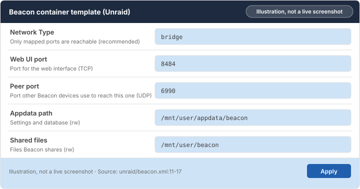
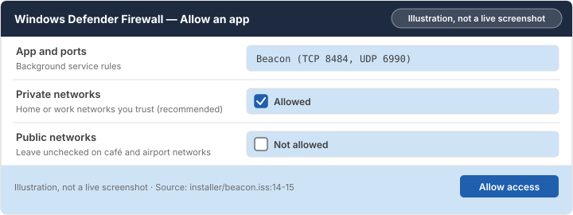

# Chapter 2: Install Beacon

Install Beacon with the method you picked in Chapter 1, with its folders mapped so updates keep your data.

> [!NOTE]
> **What you will learn**
> - Install Beacon from the Unraid app catalog.
> - Set each template field to its safe value.
> - Install Beacon with Docker Compose or the Windows installer.

## 2.1 Install on Unraid

<!-- index: Unraid; Apps tab -->

To install Beacon from the app catalog:

1. In the Unraid web interface, open the **Apps** tab.
2. Search for `Beacon` and select **Install** on the Beacon result.
   **Result:** The Beacon template opens with its fields filled in.
3. Check each field against the next section, then select **Apply**.
   **Result:** Unraid downloads Beacon and starts it. **Docker** lists `beacon` as started.


*Figure 2.1: Unraid template with the ports and mapped folders filled in. Illustration, not a live screenshot.*

## 2.2 Template fields

<!-- index: template fields; appdata; port mapping -->

Keep the defaults unless a field below says when to change it.

### Web UI port

The [port](glossary.md#port-mapping) your browser uses to open Beacon.

**Recommended:** `8484`. Change it only if another app already uses `8484`.

**Safe to change later:** Yes. Change the host side only; the [container](glossary.md#container) side stays `8484`.

### Peer port

The port other Beacon devices use to reach this one. It uses [UDP](glossary.md#udp).

**Recommended:** `6990`, protocol UDP.

**Unsafe:** Forwarding this port on your router without a reason. Leave it unforwarded unless Chapter 5 tells you to add it.

### Appdata path

Where Beacon keeps its settings and database. This folder survives updates and is the one to back up.

**Recommended:** `/mnt/user/appdata/beacon`, on the appdata share kept on your cache pool.

> [!CAUTION]
> Never copy files between a `/mnt/user/...` path and a `/mnt/cache/...` path of the same share. The copy can erase the file. Copy within one kind of path only.

### Shared files

The folder whose files Beacon shares between your devices.

**Recommended:** A share of its own, such as `/mnt/user/beacon`.

### Network type

How the [container](glossary.md#container) joins your network. The template sets it under **Network Type**.

**Recommended:** **Bridge**. Only the two ports above are reachable.

| Option | When to use it |
|---|---|
| **Bridge (recommended)** | Always, for Beacon. |
| Host | Not needed for Beacon. Every port Beacon opens becomes reachable on your network. |
| Custom (br0) | Not needed for Beacon. The container gets its own address on your network. |

## 2.3 Install with Docker Compose

<!-- index: Docker Compose -->

Use this on any Linux machine with Docker installed. The compose file maps `./config` (appdata) and `./data` (shared files) next to it.

To install with Docker Compose:

1. Create a folder named `beacon` and save the project's `docker-compose.yml` in it.
2. Open a terminal in that folder and run the command below.

   In the terminal, inside the `beacon` folder, paste:

   ```bash
   docker compose up -d
   ```

   **Result:** Docker downloads Beacon and starts it. `docker compose ps` shows `beacon` as running.

## 2.4 Install on Windows

<!-- index: Windows installer; firewall; SmartScreen -->

The installer adds Beacon as a background [service](glossary.md#service) and keeps its data in `C:\ProgramData\Beacon`.

To install on Windows:

1. Download `BeaconSetup.exe` from the project's **Releases** page on GitHub.
2. Run it. If **Windows protected your PC** appears, select **More info** and check that the publisher is Example Beacon Contributors, then select **Run anyway**.
3. Approve the administrator prompt. The installer needs it to add the service.
4. When **Windows Defender Firewall** asks, check **Private networks** only and select **Allow access**.
   **Result:** Beacon starts, and `http://localhost:8484` opens its sign-in page.


*Figure 2.2: Windows Defender Firewall prompt with Private networks selected. Illustration, not a live screenshot.*

> [!WARNING]
> Don't check **Public networks**. Anyone on a café or airport network could reach Beacon. Keep it on **Private networks** only.

Real-time scanning slows Beacon's database. Exclude only its data folder: in **Windows Security**, open **Virus & threat protection** > **Manage settings** > **Exclusions** and add `C:\ProgramData\Beacon`.

## 2.5 Check your understanding

1. Another app already uses port `8484`. Which side of the mapping do you change?
2. Windows asks which networks may reach Beacon. Which box do you check?

> [!TIP]
> **Key takeaways**
> - Map the appdata folder before the first start.
> - Keep **Bridge** networking and the default ports.
> - On Windows, allow private networks only.

<!-- nav:start -->
---

[← Chapter 1: Before you start](01-before-you-start.md) · [Contents](README.md#contents) · [Chapter 3: Set up Beacon →](03-set-up-beacon.md)
<!-- nav:end -->
